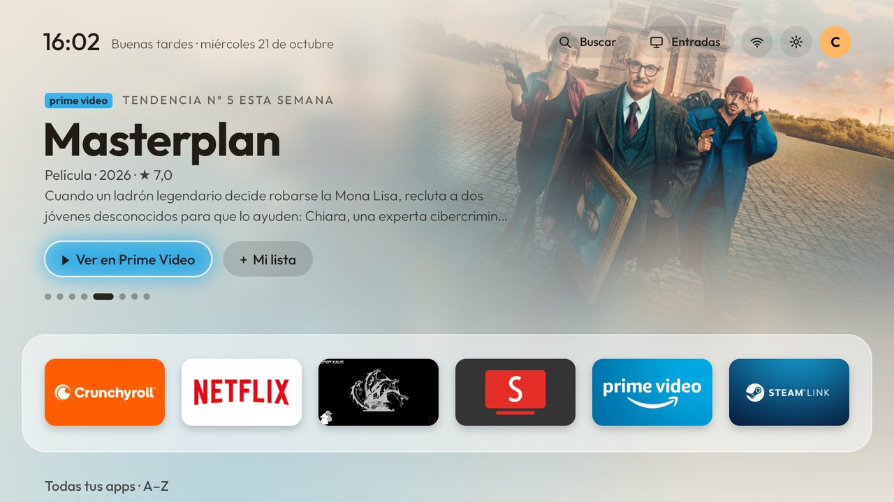
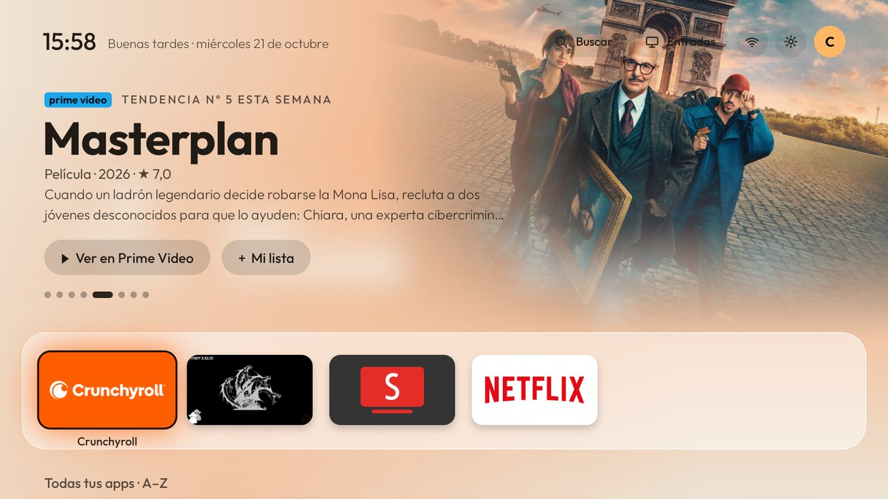
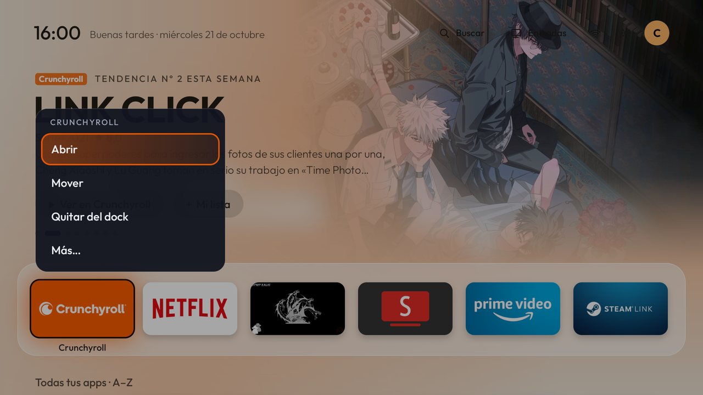
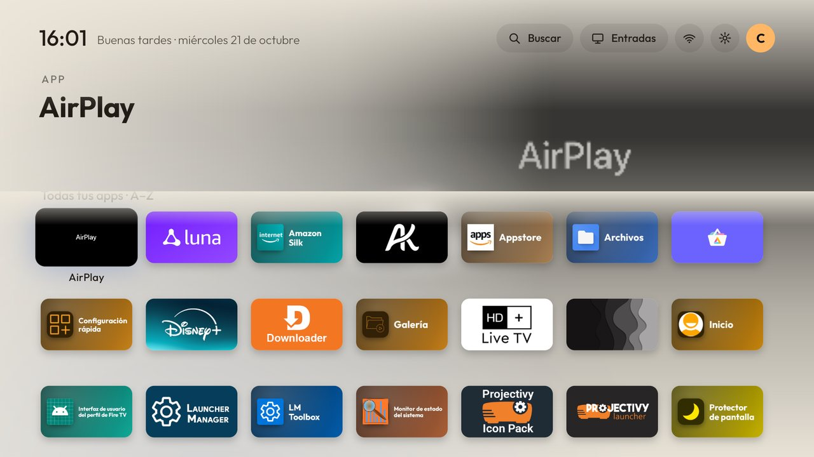
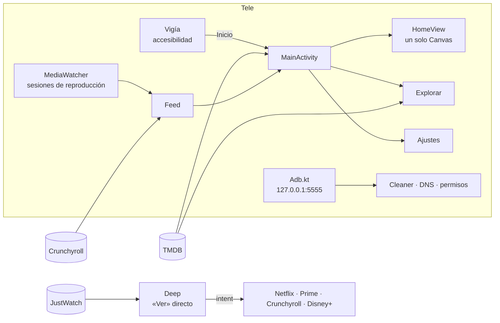

<div align="center">


# SalaTV

**Un inicio limpio, rápido y bonito para Fire TV y Android TV.**
Sin anuncios, sin banners patrocinados y con lo que de verdad estás viendo en primer plano.


[Qué hace](#qué-hace) · [Instalar](#instalar) · [Configurar](#configurar) · [Cómo funciona](#cómo-funciona) · [Privacidad](#privacidad) · [Desarrollo](#desarrollo)



</div>

## Por qué

El inicio de Amazon gasta media pantalla en anunciar lo que Amazon quiere venderte. SalaTV lo cambia por uno hecho para el mando y para la casa:

- **Lo tuyo primero.** Arriba van tus capítulos nuevos y lo más visto de la semana, pero solo en las apps que tienes.
- **Seguir viendo de verdad.** Ves los capítulos, no las apps: tu cuenta de Crunchyroll y lo que se reproduce en la tele, juntos.
- **«Ver» abre el título.** Entra directo en la serie o la peli dentro de Netflix, Prime Video, Crunchyroll o Disney+, en vez de dejarte en su menú.
- **Ligero.** Kotlin sin AndroidX ni librerías. El inicio entero se dibuja en un solo `Canvas`.
- **Se cuida solo.** Un vigía devuelve el botón Inicio a SalaTV, y una red de seguridad te lleva al inicio original si algo falla.

Nace de lo que ya hacía [CleanYourTV](https://github.com/Gathin23/cleanyourtv) y toma ideas de [Free My TV](https://github.com/simbasjungles/free-my-tv).

## Qué hace

<table>
<tr>
<td width="50%"></td>
<td width="50%"></td>
</tr>
<tr>
<td><b>Carrusel de tendencias.</b> Tus episodios nuevos y las tendencias de la semana en tus apps, con el logo del título, su nota y un fondo que se acerca despacio.</td>
<td><b>Menú en burbuja.</b> Mantén OK sobre cualquier cosa: cuatro opciones a mano y el resto en «Más…», junto a lo que tocaste.</td>
</tr>
<tr>
<td></td>
<td>

**Todas tus apps.** Les pinta un banner a las que no lo tienen. Puedes ordenarlas A–Z, por uso, por las más recientes o por tipo, cada perfil a su manera. También hay carpetas y apps ocultas.

**De día y de noche.** El tema cambia con el atardecer real de tu ciudad.

</td>
</tr>
</table>

### Ver y seguir viendo

| | |
|---|---|
| **Seguir viendo** | Capítulos y pelis a medias de tu cuenta de Crunchyroll y de lo que reproduces en la tele. Te avisa cuando sale un episodio nuevo. Cada perfil de la casa tiene su fila. |
| **«Ver» entra en el título** | Busca el enlace exacto de cada servicio en JustWatch y lo abre con el formato que entiende cada app (ver abajo). Si no lo encuentra, abre la búsqueda de la app con el título ya escrito. |
| **Mi lista · Crunchyroll** | Es tu lista de Crunchyroll de verdad: lo que añades desde SalaTV aparece en la app y al revés. Solo sale en títulos que están en Crunchyroll. |
| **Al encender** | Puede abrir el inicio, tu app de esa hora, la última app, una entrada HDMI o preguntarte si sigues con el último capítulo. |
| **Doble Inicio** | Pulsa Inicio dos veces seguidas y vuelves a la app donde estabas. |

<details>
<summary><b>Cómo abre cada app su título</b></summary>

Lo comprobamos en la propia tele con los filtros de intents de cada app (`dumpsys package`):

| App | Enlace que acepta | Qué abre SalaTV |
|---|---|---|
| Netflix | `https://www.netflix.com/title/<id>` | La ficha del título |
| Prime Video | `https://app.primevideo.com/detail?gti=…` | La ficha del título |
| Crunchyroll | Solo `crunchyroll://` | `crunchyroll://series/<id>`, o `crunchyroll://watch/<id>` para seguir en el capítulo exacto |
| Disney+ | `disneyplus://` | El enlace de JustWatch con el esquema de Disney+ |

Netflix y Prime Video no dejan que otras apps añadan títulos a su «Mi lista», así que SalaTV no ofrece ese botón con ellas.

</details>

### Descubrir

| | |
|---|---|
| **Explorar** | Una pantalla con tres pestañas: **Películas**, **Series** y **Anime**. Cada una trae muchas estanterías por género y por servicio, solo con lo que está en tus apps en tu país. |
| **Porque viste…** | Títulos parecidos a lo último que viste, en el inicio y en Explorar. |
| **Ficha completa** | Logo, sinopsis, «▶ Seguir · T2 · E7» si lo tenías a medias, temporadas con sus episodios y «Aquí te quedaste», reparto, tráiler en SmartTube y títulos parecidos. |
| **Buscar** | Escribe y salen los pósteres con las apps donde está cada título. |

### Más fluido

Hay foco con efecto muelle y profundidad al moverte: el fondo se desliza un poco con el dock. El póster crece hasta convertirse en la ficha. Mientras cargan, las tarjetas brillan, y las imágenes siguientes se precargan antes de que llegues. Todo se mide con `dumpsys gfxinfo`: solo el 8 % de fotogramas lentos en una Fire TV de gama media.

### Ajustes

Están detrás de la rueda de arriba, en dos columnas: categorías a la izquierda y sus opciones a la derecha.

- **Vista previa en directo.** Un inicio en miniatura cambia según tocas el tema, el tamaño, el carrusel o las filas.
- **Interruptores y deslizadores.** ← → para el tamaño, la velocidad del carrusel, el volumen nocturno y «¿Sigues ahí?».
- **Cuentas y servicios.** Estado de Crunchyroll, TMDB y los enlaces directos, cuándo se actualizó todo por última vez y un botón para actualizar ahora.
- **Comprobar todo.** Revisa el vigía, los permisos, internet, el DNS, la hora, TMDB, Crunchyroll, el espacio y los cierres. Cada fallo trae su botón para arreglarlo.
- **Buscar en ajustes.** Escribe «volumen» o «dock» y salen las opciones de todas las categorías.

### La tele, limpia

| | |
|---|---|
| **Vigía del botón Inicio** | Un servicio de accesibilidad que te devuelve a SalaTV cuando Fire OS abre su inicio. |
| **Limpieza por modelo** | Las 158 listas de CleanYourTV: desactiva las apps de anuncios y rastreo de tu modelo y avisa si alguna vuelve tras una actualización. |
| **DNS privado** | AdGuard para toda la tele, con comprobación: si los nombres no se resuelven, lo quita solo. |
| **ADB desde la propia tele** | Habla con `127.0.0.1:5555` para lo que antes había que hacer desde el PC. |
| **Noche** | Tope de volumen nocturno y «¿Sigues ahí?», que apaga la tele si nadie toca el mando. |
| **Apps con PIN** | Un código de 4 cifras, que se pide también si la app se abre desde fuera de SalaTV. |
| **Red de seguridad** | Si SalaTV se cierra 3 veces en 5 minutos, el botón Inicio vuelve solo al de Amazon. |
| **Apps recomendadas** | SmartTube, Stremio, TV Bro, Kodi y VLC, con aviso de versiones nuevas. |

## Instalar

**Necesitas:** una Fire TV (Fire OS 7 u 8) o una tele con Google TV / Android TV 9 o superior, con la depuración ADB activada (Ajustes › Mi Fire TV › Opciones para desarrolladores). En el PC, Android Studio o su JDK.

```powershell
git clone https://github.com/XsharklinX/SalaTV.git
cd SalaTV
.\tools\instalar.ps1 -Tele 192.168.1.50   # IP de tu tele
```

`instalar.ps1` compila, instala y comprueba que el vigía arranca. Antes guarda la versión que había en `copias\`, y si el botón Inicio deja de llevar a SalaTV, vuelve sola a esa versión.

¿Varias teles? `python tools\instalador.py` busca en la red las que tienen la depuración activa, dice el modelo de cada una, instala SalaTV y aplica la lista de limpieza que le toca.

**La primera vez, en la tele:**

1. Abre **SalaTV** desde «Tus apps» (o «Alexa, abre SalaTV»).
2. Arriba sale **Configurar**. Entra y pulsa **Configurar todo**.
3. La tele pregunta «¿Permitir la depuración?». Marca **Permitir siempre** y acepta.

Eso activa el vigía y da los cuatro permisos: ajustes del sistema, uso de apps, ver lo que se reproduce e instalar apps. En Google TV, además, deja SalaTV como inicio de la tele.

## Configurar

### TMDB: tendencias, Explorar y fichas

Crea una cuenta gratis en [themoviedb.org](https://www.themoviedb.org/settings/api) y copia el **token de lectura de la API**. Ponlo en `local.properties`, que no se sube al repositorio:

```properties
tmdb.token=eyJhbGciOi...
```

La compilación lo mete en la app. Sin token, SalaTV funciona igual, pero sin carrusel, Explorar ni fichas.

### Crunchyroll: Seguir viendo, episodios nuevos y Mi lista

Hay dos maneras:

- En la tele: **Ajustes › Cuentas y servicios › Conectar Crunchyroll**.
- Desde el PC, sin escribir con el mando: `.\tools\claves.ps1`, que pide la contraseña sin mostrarla.

SalaTV guarda solo el token de sesión, nunca la contraseña. Cada perfil de SalaTV puede usar un perfil distinto de Crunchyroll.

> [!NOTE]
> La conexión con Crunchyroll y los enlaces de JustWatch usan sus API **no oficiales**. Pueden dejar de funcionar si cambian; SalaTV lo apunta en **Ajustes › Tele › Registro de problemas** y sigue funcionando sin ellos.

## Cómo funciona



<details>
<summary><b>Mapa del código</b></summary>

| Archivo | Qué hay |
|---|---|
| `HomeView.kt` | El inicio, dibujado a mano sobre una rejilla de 960×540. Foco con muelle, parallax, carrusel y zoom al abrir. |
| `MainActivity.kt` | Monta las filas, las tendencias y los menús. Refresca internet cada 5 minutos como mucho. |
| `Explore.kt` | Explorar: pestañas, estanterías, precarga y transición a la ficha. |
| `Pages.kt` | Ficha del título, buscador y «Seguir donde lo dejé». |
| `Settings.kt` | Ajustes en dos columnas, vista previa, interruptores, deslizadores y «Comprobar todo». |
| `Tmdb.kt` | Tendencias, estanterías, logos, fichas, temporadas y «Porque viste». |
| `JustWatch.kt` | Enlaces exactos por servicio (`JustWatch`) y cómo abrirlos en cada app (`Deep`). |
| `Crunchy.kt` | Sesión, Seguir viendo, temporada, perfiles y lista de Crunchyroll. |
| `Feed.kt`, `Media.kt` | Seguir viendo de Crunchyroll y de las sesiones de la tele, Mi lista y Porque viste. |
| `Vigia.kt` | Servicio de accesibilidad: botón Inicio, doble Inicio, encendido, PIN y botones del mando. |
| `Adb.kt` | Cliente ADB con clave RSA propia para hablar con la tele desde la tele. |
| `Cleaner.kt`, `Tools.kt` | Limpieza, DNS, permisos, salud de la tele y botones del mando. |
| `Ui.kt` | Filas finas con halo de color, burbujas, avisos y diálogos. |

</details>

## Privacidad

- No hay cuentas propias, analítica ni anuncios.
- Lo que ves no sale de la tele. Seguir viendo se guarda en la memoria de la app.
- Solo se conecta a TMDB (tendencias y fichas), JustWatch (enlaces), Crunchyroll (si lo conectas) y GitHub (versiones de las apps recomendadas). Todo eso se apaga con **Ajustes › Cuentas y servicios › Usar internet**.
- La contraseña de Crunchyroll no se guarda, solo su token de sesión.

## Limitaciones

- **4K/HDR por servicio:** TMDB no dice en qué calidad está cada título, así que no se muestra.
- **«Mi lista» de Netflix y Prime Video:** no dejan que otras apps escriban en ella.
- **Entradas HDMI en Fire OS:** cambiar de entrada es cosa de Amazon, así que SalaTV pulsa las teclas HDMI por ADB.
- **Volumen nocturno:** no funciona si el sonido va por HDMI-CEC a una barra.
- **targetSdk 30 a propósito,** para poder seguir leyendo `Settings.Global` en Fire OS.

En [docs/PRUEBAS.md](docs/PRUEBAS.md) está lo comprobado en una Fire TV real y lo que falta por probar.

## Desarrollo

```powershell
$env:JAVA_HOME = "C:\Program Files\Android\Android Studio\jbr"
.\gradlew assembleDebug           # APK de pruebas
.\gradlew testDebugUnitTest       # 25 pruebas: sol, dock, orden, enlaces, versiones, ADB, PIN, enlaces directos
```

| Herramienta | Para qué |
|---|---|
| `tools/instalar.ps1` | Compilar, instalar, comprobar el vigía y volver atrás si falla |
| `tools/instalador.py` | Instalar en otras teles de la red con su lista de limpieza |
| `tools/claves.ps1` | Conectar Crunchyroll desde el PC |
| `tools/copy_lists.py` | Actualizar las listas de limpieza desde CleanYourTV |
| `tools/make_art.py`, `tools/make_sounds.py` | Dibujar el icono y el banner, y generar los clics |

Las notas de cada versión, en español e inglés, están en [CHANGELOG.md](CHANGELOG.md).

## Créditos

- **[CleanYourTV](https://github.com/Gathin23/cleanyourtv)**: las listas de limpieza por modelo (licencia MIT, incluida en `assets/listas`).
- **[Free My TV](https://github.com/simbasjungles/free-my-tv)**: ideas para el inicio en Google TV.
- **[Outfit](https://fonts.google.com/specimen/Outfit)**: la tipografía (SIL Open Font License, en `FONT-LICENSE-OFL.txt`).
- **[crunchyroll-rs](https://github.com/crunchy-labs/crunchyroll-rs)**: las credenciales de la app de Android TV que usa la conexión con Crunchyroll.
- **[JustWatch](https://www.justwatch.com)**: dónde ver cada título y sus enlaces directos.

<a href="https://www.themoviedb.org"></a>
Este producto usa la API de TMDB, pero TMDB no lo respalda ni lo certifica.

SalaTV no está afiliado a Amazon, Netflix, Crunchyroll, Disney ni JustWatch. Sus marcas son de sus dueños.
